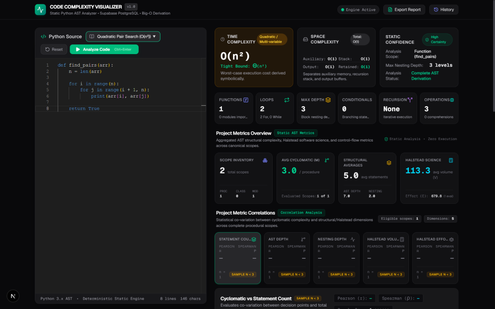
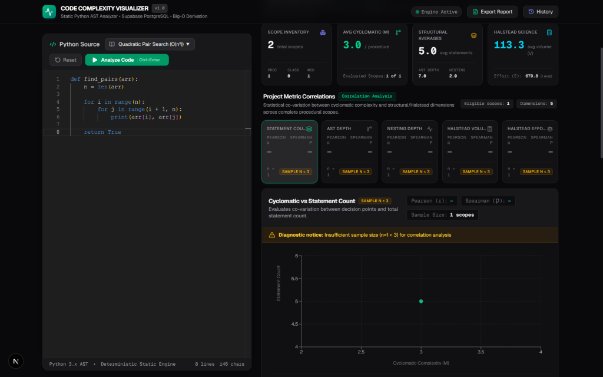
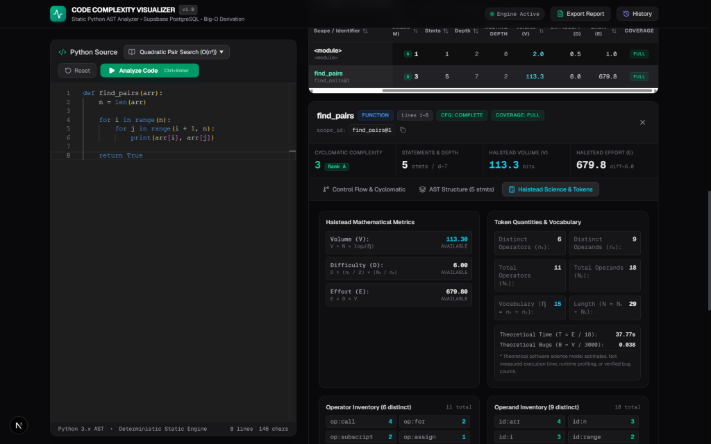
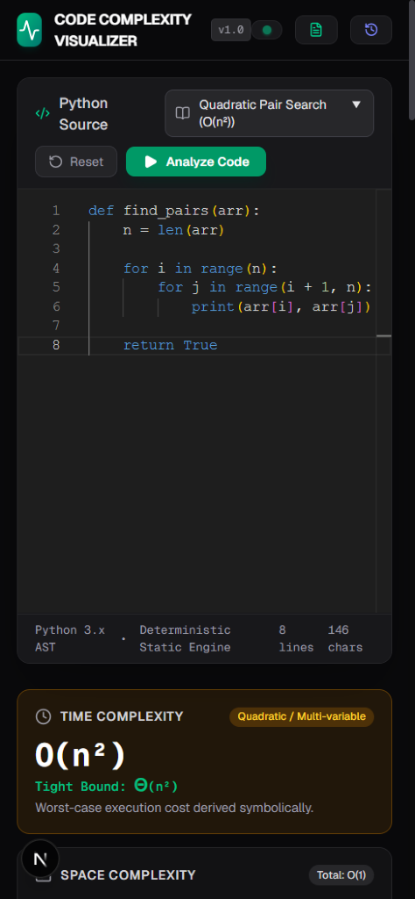

# Python Code Intelligence & Performance Workbench

A deterministic static-analysis workbench for inspecting Python program structure, measuring AST structural metrics, cyclomatic complexity, and Halstead properties, and reasoning about algorithmic time/space complexity without executing submitted source code.

> **Development baseline:** Active branch `feat/phase-1c-metrics-overview` at checkpoint `9f70e57624aca59017fc5b570e42c67340987260`. The merged upstream baseline on GitHub `main` is `c26fdd36837bc0782c9e840b370f478e306857a2`, containing all six units of Phase 1B.2 (`64adf3d256f04ff43796b933875887b2f34d3179` via PR #26). Phase 1C Units 1–4 are fully implemented, verified, and integrated into the frontend workspace.

---

## What the Workbench Does

The workbench accepts Python source code, safely parses it into an Abstract Syntax Tree (AST), and performs multi-level static analysis without code execution:

1. **Algorithmic Complexity Reasoning (Phase 1A):** Indexes functions, traces interprocedural call graphs, models loops and recurrence relationships, and composes asymptotic time and space bounds ($O(1)$, $O(\log n)$, $O(n)$, $O(n \log n)$, $O(n^2)$, etc.).
2. **Control Flow Graph & Cyclomatic Analysis (Phase 1B.1):** Builds basic-block control flow graphs for procedural scopes, evaluates graph cyclomatic complexity ($M_{\text{graph}} = E - N + 2P$) and decision cyclomatic complexity ($M_{\text{decision}} = 1 + \sum \pi_i$), analyzes reachability, and assigns risk ranks (A through F).
3. **AST Structural & Halstead Analysis (Phase 1B.2):** Discovers canonical scopes in deterministic lexical preorder, counts structural AST nodes, statements, and control nesting depths, and compiles normalized operator/operand token inventories to evaluate Halstead vocabulary ($\eta$), length ($N$), volume ($V$), difficulty ($D$), and effort ($E$).
4. **Project Correlation Analysis (Phase 1B.2):** Evaluates statistical co-variation (Pearson $r$ and Spearman $\rho$) between cyclomatic complexity and five key structural/Halstead dimensions across complete procedural scopes.
5. **Interactive Analysis Workspace (Phase 1C):** Delivers a responsive, multi-viewport dashboard with project metrics overview cards, an interactive per-scope explorer table, a multi-tab detailed scope inspector, correlation scatter plots with tooltip scope enrichment, and interactive AST control flow graphs.

---

## Visual Preview

### Analysis Workspace & Dual-Column Dashboard


### Project Metric Correlations & Scatter Plot


### Detailed Scope Inspector (Halstead Science & Token Inventories)


### Responsive Mobile Interface


---

## Current Capability Status

Evaluated against active branch `feat/phase-1c-metrics-overview` (HEAD: `9f70e57`):

| Capability | Status | Implementation Details |
|---|---|---|
| Safe Python AST parsing | Implemented | Strict static parsing with source-size (100KB), line-count (3,000), AST-node (10,000), and AST-depth (200) safety bounds. |
| Phase 1A complexity analysis | Implemented & integrated | Function indexing, call graph construction, loop bounds, recurrence equation solving, operation-cost models, and asymptotic cost composition. |
| CFG construction & cyclomatic analysis | Implemented & integrated | Basic-block CFG generation with reachable edge/node accounting, decision point categorization, discrepancy checks, and risk ranking. |
| Phase 1B.2 unified metrics pipeline | Implemented & integrated | `UnifiedMetricsPipeline` coordinates scope discovery, structural metrics, Halstead analysis, procedural CFGs, correlation analysis, and project aggregation. |
| Phase 1C frontend dashboard | Implemented & integrated | `MetricsOverview`, `ScopeMetricsTable`, `ScopeInspector`, `ProjectCorrelationSection`, and workspace UX refinements across 4 viewports. |
| Analysis history persistence | Implemented (legacy fields) | Persists core complexity, legacy statistics, AST structure, and theoretical graph data to SQLite/PostgreSQL. Dynamic Phase 1B.2 metrics are not persisted. |
| Runtime profiling / execution | Not implemented (by design) | Zero-execution static analysis boundary: submitted code is never executed; no runtime wall-clock benchmarks are generated. |
| Automatic code rewriting | Not implemented | Optimization suggestions are static analytical hints; no semantic AST rewrite engine is present. |

---

## Architecture at a Glance

```text
                  User / Browser
                        |
                        v
              Next.js Frontend (Page / Monaco)
                        |
                        | POST /api/analyze
                        v
                 FastAPI Backend
                        |
                        v
              Safe Static AST Parser (ast.parse)
                        |
                        v
                 Scope Discovery (Lexical Preorder)
                        |
          +-------------+-------------+
          |             |             |
          v             v             v
      Structural    Halstead       CFG /
       Metrics       Metrics    Cyclomatic
          |             |             |
          +-------------+-------------+
                        |
                        v
              Unified Metrics Pipeline
                        |
          +-------------+-------------+
          |                           |
          v                           v
      Scope Metrics             Project Metrics
   (UnifiedScopeMetrics[])   (ProjectMetricsSummary)
          |                           |
          +-------------+-------------+
                        |
                        v
                 API Response (AnalyzeResponse)
                        |
                        v
                 Next.js Frontend (React 19)
                        |
          +-------------+-------------+
          |             |             |
          v             v             v
       Overview    Correlations    Scope Explorer
  (MetricsOverview) (ProjectCorrelation) (ScopeMetricsTable)
                                      |
                                      v
                                Scope Inspector
                                (ScopeInspector)
```

For complete architectural details, see [System Architecture Overview](docs/architecture/system-overview.md), [Phase 1B Metrics Contract](docs/architecture/phase-1b-metrics.md), and [Phase 1C Frontend Integration](docs/architecture/phase-1c-frontend-integration.md).

---

## Technology Stack

### Backend
- **Python `>=3.11`** (declared in `backend/pyproject.toml`)
- **FastAPI** (`>=0.115.0`) & **Uvicorn** (`>=0.32.0`)
- **Pydantic v2** (`>=2.9.0`) & **pydantic-settings** (`>=2.6.0`)
- **SQLAlchemy 2.x** (`>=2.0.36`) & **Alembic** (`>=1.14.0`)
- **Psycopg 3** (`>=3.2.0`) for PostgreSQL connectivity
- **Pytest** (`>=8.3.0`) & **HTTPX** (`>=0.28.0`) for automated testing
- **`uv`** package manager with checked-in `uv.lock`

### Frontend
- **Node.js `>=20.0.0`** (declared in `frontend/package.json`)
- **Next.js 16.3.6** (App Router, Turbopack dev, Webpack build) & **React 19.2.8**
- **TypeScript 5** & **Tailwind CSS v4**
- **Monaco Editor** (`@monaco-editor/react`) for code editing
- **React Flow** (`@xyflow/react`) for interactive AST hierarchy diagrams
- **Recharts** (`^3.10.1`) for theoretical asymptotic curves and correlation scatter plots
- **Lucide React** for technical iconography

### Persistence
- **SQLite Fallback:** Default local database (`sqlite+pysqlite:///./complexity.db`) created automatically via SQLAlchemy metadata.
- **PostgreSQL:** Supported through SQLAlchemy connection strings configured in `DATABASE_URL`.
- **Persistence Boundary:** Legacy complexity fields are stored in `AnalysisResult`; Phase 1B.2 scope and project metrics are dynamically computed per analysis and are not stored in historical tables.

---

## Local Development & Setup

See [DEVELOPMENT.md](DEVELOPMENT.md) for full developer instructions.

### Prerequisites
- Python `>=3.11`
- Node.js `>=20`
- `uv` (recommended for Python package management)
- `npm`

### 1. Backend Setup

```powershell
cd backend

# Create local environment configuration
Copy-Item ..\.env.example .env

# Install dependencies with dev extra
uv sync --extra dev

# Start FastAPI development server
uv run uvicorn app.main:app --reload --host 127.0.0.1 --port 8000
```

Backend endpoints:
- API Root: `http://127.0.0.1:8000/`
- Interactive Swagger Docs: `http://127.0.0.1:8000/docs`
- Static Analysis: `POST http://127.0.0.1:8000/api/analyze`
- Service Health: `GET http://127.0.0.1:8000/api/health`
- Analysis History: `GET http://127.0.0.1:8000/api/history`

### 2. Frontend Setup

```powershell
cd frontend

# Install clean dependencies
npm ci

# Start Next.js development server
npm run dev
```

The frontend will be available at `http://localhost:3000`.

---

## Verification & Quality Gates

The project maintains rigorous multi-layer quality gates across backend and frontend codebases:

### Frontend Verification

```powershell
cd frontend

# 1. ESLint check
npm run lint

# 2. TypeScript typecheck
npx tsc --noEmit

# 3. Next.js production Webpack build
npm run build
```

### Backend Verification

```powershell
cd backend

# Run metrics pipeline integration suite
uv run pytest tests/test_metrics_pipeline_integration.py -v

# Run full offline test suite
uv run pytest tests/ -v
```

---

## Static-Analysis & Security Boundary

1. **Zero Execution of Submitted Code:** Submitted Python source code is parsed exclusively into syntax tree data via `ast.parse` and statically analyzed. It is never executed via `eval`, `exec`, or dynamic worker subprocesses.
2. **Parser Resource Guardrails:**
   - Maximum source length: **100,000 bytes**
   - Maximum lines of code: **3,000 lines**
   - Maximum AST nodes: **10,000 nodes**
   - Maximum AST nesting depth: **200 levels**
   *Note:* Node count and depth checks run post-parse; environments exposed to untrusted input should enforce process memory limits and operating system sandboxing.
3. **Static Limitations:** Static analysis produces algorithmic estimations and structural metrics. It does not measure wall-clock execution time, actual peak resident memory, or dynamic path feasibility for specific runtime inputs.
4. **Halstead Model Transparency:** Theoretical time ($T = E / 18$) and estimated delivered bugs ($B = V / 3000$) are model-derived formulas based on AST token counts, not empirical benchmarks or verified defects.
5. **Statistical Correlation Boundaries:** Pearson ($r$) and Spearman ($\rho$) correlation coefficients indicate descriptive co-variation across evaluated procedural scopes; they do not establish causation or runtime prediction.

See [SECURITY.md](SECURITY.md) for full vulnerability reporting and security boundaries.

---

## Winter of Code Social (WOCS) 2026

This project participates in **[Winter of Code Social (WOCS) 2026](https://woc.codesocial.tech/)**, an open-source mentorship initiative organised by Code Social.

External contributors, student developers, and open-source participants are welcome to contribute! To ensure a smooth onboarding process:

1. **Find Available Issues:** Browse open, unassigned tasks on the project's [GitHub Issues tracker](https://github.com/KartikeyG-world/pycode-intelligence-workbench/issues).
2. **Review Contribution Standards:** Read the [CONTRIBUTING.md](CONTRIBUTING.md) guide for strict static-analysis invariants, branch naming conventions, and testing expectations.
3. **Request Issue Assignment:** Leave a comment on the relevant issue expressing interest and outlining your proposed technical approach.
4. **Wait for Formal Assignment:** **Do not begin work or submit a pull request until a Project Admin or Mentor explicitly assigns the issue to you.** Unassigned pull requests will be closed.
5. **Follow the Code of Conduct:** All participants must abide by the project's [CODE_OF_CONDUCT.md](CODE_OF_CONDUCT.md) across all discussions and reviews.
6. **Join Community Discussions:** Connect with maintainers and participants in the **[Code Social Discord Server](https://discord.gg/MSTNyRSPYW)**.

---

## Documentation Map

- [Development and Operations Guide](DEVELOPMENT.md)
- [Technical Documentation Index](docs/README.md)
- [System Architecture Overview](docs/architecture/system-overview.md)
- [Phase 1B Metric Contracts & Specifications](docs/architecture/phase-1b-metrics.md)
- [Phase 1C Frontend Metrics Integration](docs/architecture/phase-1c-frontend-integration.md)
- [Analysis History API Specification](docs/api/ANALYSIS_HISTORY_API.md)
- [Testing Strategy & Evidence Guidelines](docs/development/testing.md)
- [Contribution Guidelines](CONTRIBUTING.md)
- [Code of Conduct](CODE_OF_CONDUCT.md)
- [Security Policy](SECURITY.md)
- [Project License](LICENSE)

---

## Known Documentation and Integration Gaps

1. The runtime default `PROJECT_NAME` in `backend/app/core/config.py` and `.env.example` uses the legacy name `Code Complexity Visualizer`; this is an intentional configuration-alignment item, not a claim that the runtime title has been modified.
2. In restricted Windows sandboxes lacking loopback socket permissions, Starlette `TestClient` tests may fail during socketpair creation. API transport verification must be executed in an environment permitting local loopback sockets.
3. Historical analysis records created under the Stage 1.0.2 schema do not persist Phase 1B.2 scope or project metrics; historical views display explicit missing-data state indicators.

---

## Repository Baseline

- **Repository:** `KartikeyG-world/pycode-intelligence-workbench`
- **Active Development Branch:** `feat/phase-1c-metrics-overview`
- **Latest Implementation Checkpoint:** `9f70e57624aca59017fc5b570e42c67340987260`
- **Upstream Main Baseline:** `c26fdd36837bc0782c9e840b370f478e306857a2`
- **Merged Phase 1B.2 Checkpoint:** `64adf3d256f04ff43796b933875887b2f34d3179` (PR #26)
