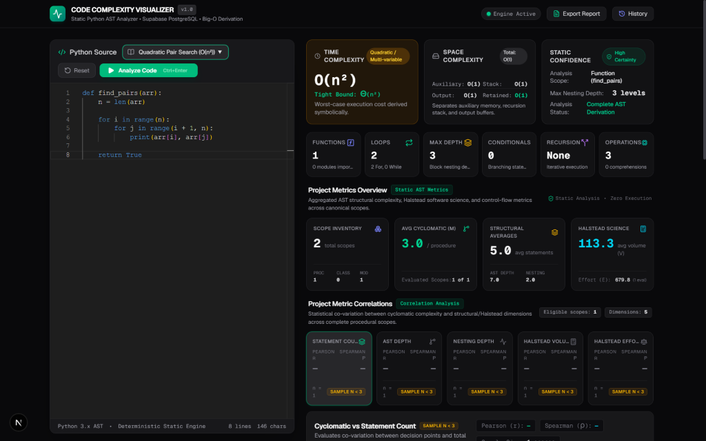
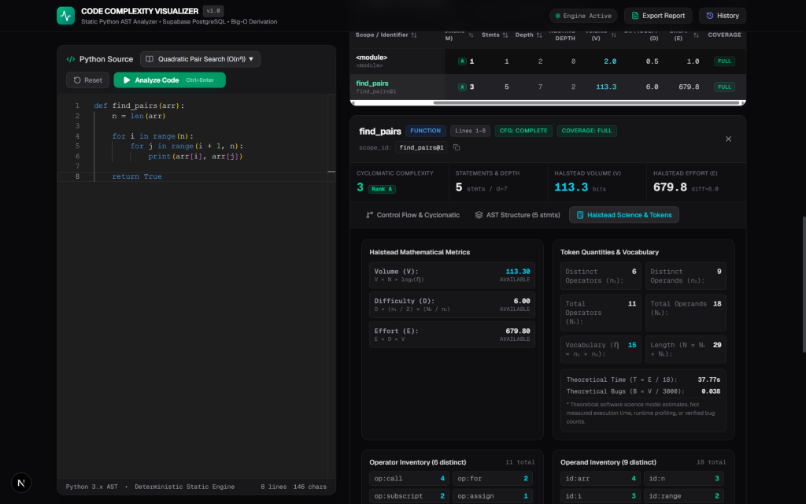
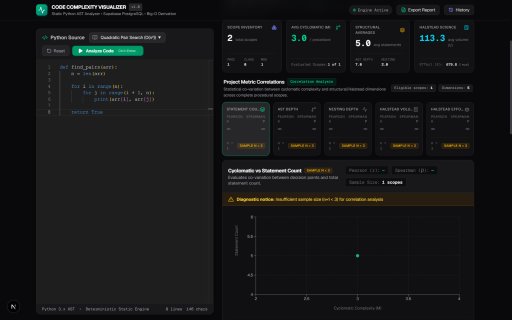
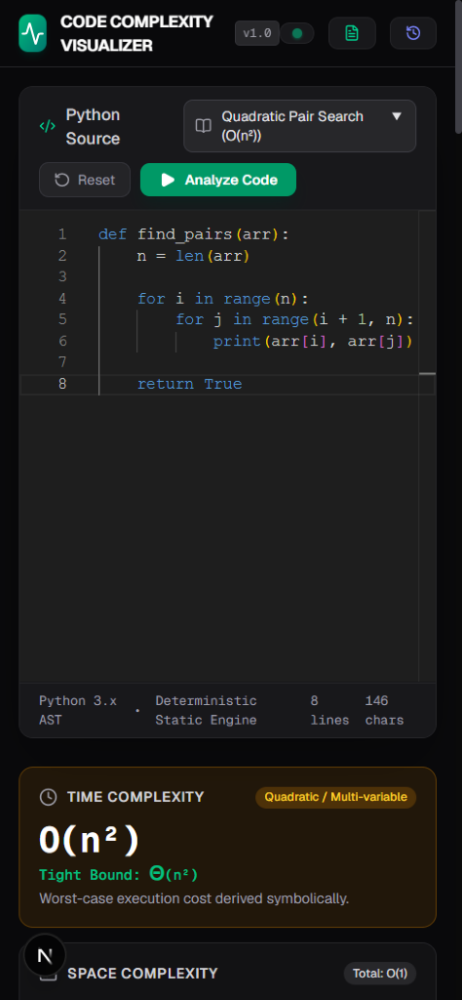

# Phase 1C Frontend Metrics Integration Architecture

**Phase:** Phase 1C — Frontend Metrics Integration
**Development Branch:** `feat/phase-1c-metrics-overview`
**Pre-remediation PR snapshot:** `d9753f4e79ed4d15069f13b1060ce151a82f99fb`
**Phase 1C Implementation Checkpoint:** `9f70e57624aca59017fc5b570e42c67340987260`
**Backend Baseline Checkpoint:** `64adf3d256f04ff43796b933875887b2f34d3179` (merged into `main` via PR #26)  
**Parent Documentation:** [System Architecture Overview](system-overview.md) | [Phase 1B Metrics Contract](phase-1b-metrics.md)

---

## 1. Executive Summary

Phase 1C integrates the rich static-analysis metrics produced by the Phase 1B.2 unified metrics pipeline into the Python Code Intelligence & Performance Workbench web interface.

Prior to Phase 1C, the frontend visualized only Phase 1A interprocedural analysis, asymptotic complexity bounds, legacy code statistics, and AST hierarchy graphs. Phase 1C delivers an end-to-end, multi-level analytical dashboard comprising:

1. **Unit 1 — Project Metrics Overview & Scope Explorer:** High-level project summary cards and an interactive, sortable per-scope metrics table (`MetricsOverview.tsx`, `ScopeMetricsTable.tsx`).
2. **Unit 2 — Detailed Scope Inspector:** Deep-dive modal/drawer inspection for individual procedural and non-procedural scopes, detailing control-flow graph topology, AST structural distributions, Halstead token inventories, and syntax coverage diagnostics (`ScopeInspector.tsx`).
3. **Unit 3 — Project Correlation Visualization:** Statistical co-variation analysis between cyclomatic complexity and structural/Halstead dimensions via Pearson/Spearman metrics, status diagnostics, and an enriched scatter plot (`ProjectCorrelationSection.tsx`).
4. **Unit 4 — Workspace Integration & UX Refinement:** Cohesive end-to-end workspace ergonomics, sticky desktop editor layout, responsive table pinning with zero text bleed, dark-themed React Flow controls, and state cleanup on editor reset.



---

## 2. Architecture & Request-Response Lifecycle

The frontend consumes live analysis data via `POST /api/analyze`. The API response schema (`AnalyzeResponse`) populates two primary fields for Phase 1C:

- `scope_metrics: List[UnifiedScopeMetrics]`: Array of canonical scope records ordered in deterministic lexical preorder.
- `project_metrics: Optional[ProjectMetricsSummary]`: Project-wide aggregation summarizing procedural averages, diagnostic populations, and the 5 approved correlation dimensions.

```text
                  User / Browser
                        |
                        | Python Source Code
                        v
              Next.js Frontend (Page / Monaco)
                        |
                        | POST /api/analyze
                        v
                 FastAPI Backend
                        |
                        v
              Safe Static AST Parser (ast.parse)
                        |
                        v
                 Scope Discovery (Lexical Preorder)
                        |
          +-------------+-------------+
          |             |             |
          v             v             v
      Structural    Halstead       CFG /
       Metrics       Metrics    Cyclomatic
          |             |             |
          +-------------+-------------+
                        |
                        v
              Unified Metrics Pipeline
                        |
          +-------------+-------------+
          |                           |
          v                           v
      Scope Metrics             Project Metrics
   (UnifiedScopeMetrics[])   (ProjectMetricsSummary)
          |                           |
          +-------------+-------------+
                        |
                        v
          AnalyzeResponse (JSON payload)
                        |
                        v
              Next.js Frontend (React 19)
                        |
          +-------------+-------------+
          |                           |
          v                           v
   Project Metrics             Per-Scope Explorer
   - MetricsOverview           - ScopeMetricsTable
   - ProjectCorrelationSection        |
                                      v
                               Scope Inspector
                               (ScopeInspector)
```

### Critical Data Invariant
**All statistical metrics, cyclomatic numbers, Halstead quantities, and correlation coefficients are calculated strictly on the backend.** The frontend never recalculates statistical numbers, never alters correlation pairs, and never substitutes fabricated values or synthetic zeros for missing or undefined metrics.

---

## 3. Unit 1: Project Metrics Overview & Scope Explorer

### 3.1 Project Metrics Overview (`MetricsOverview.tsx`)
Displays aggregate static metrics across procedural and project scopes:
- **Procedural Scope Summary:** Procedural scopes count (`function` + `method`), module scopes count, and class scopes count.
- **Structural Averages:** Average statement count, average AST depth, and average control-nesting depth across procedural scopes.
- **Cyclomatic Complexity Average:** Mean cyclomatic complexity evaluated strictly across scopes where `cyclomatic_status == COMPLETE` (using the backend `cyclomatic_evaluated_scopes` denominator).
- **Halstead Complexity Averages:** Mean volume and effort evaluated strictly across scopes where `syntax_coverage_status == FULL` (using `halstead_volume_evaluated_scopes` and `halstead_effort_evaluated_scopes`).
- **Diagnostic Badges:** Displays counts of scopes with partial Halstead coverage (`partial_coverage_volume_scopes`) or unclassified syntax nodes (`unclassified_syntax_scopes`).

### 3.2 Scope Metrics Explorer (`ScopeMetricsTable.tsx`)
Presents a sortable data table of all canonical scopes discovered in the AST:
- **Canonical Ordering:** Defaults to the backend's deterministic lexical preorder (parent scopes before nested children; siblings in source line order).
- **Multi-Column Sorting:** Interactive sorting on Scope Name, Type, Line Number, Cyclomatic Complexity ($M$), Statements, AST Depth, and Halstead Volume ($V$).
- **Reset to Canonical Order:** A dedicated reset button restores the original lexical preorder hierarchy.
- **Scope Identity:** Displays the canonical `scope_id` (e.g. `function:find_pairs@2:0`, `class_body:Searcher@10:4`) alongside human-readable scope names.
- **Selection Handling:** Clicking any row dispatches selection to open the Detailed Scope Inspector.
- **Historical Fallback:** When viewing historical submissions where `scope_metrics` were not persisted, displays an explicit informational notice rather than empty or broken table rows.

---

## 4. Unit 2: Detailed Scope Inspector (`ScopeInspector.tsx`)

The Detailed Scope Inspector opens when a scope row is selected, providing comprehensive drill-down analysis across three tabbed views:



### 4.1 Tab 1: Overview & Cyclomatic Complexity
- **Control Flow Graph Status:** Clearly indicates evaluation state (`COMPLETE`, `PARTIAL`, or `UNSUPPORTED`).
- **Complexity Metrics:** Displays unified cyclomatic complexity, graph cyclomatic ($M_{\text{graph}} = E - N + 2P$), decision cyclomatic ($M_{\text{decision}} = 1 + \sum \pi_i$), and any discrepancy.
- **Risk Ranking:** Displays color-coded risk bands (A through F) with explicit provisional tags if `is_provisional == true`.
- **CFG Reachability Topology:** Reports total basic blocks (nodes), total edges, reachable nodes/edges, and unreachable basic block counts.
- **Decision Points Breakdown:** Categorizes control decisions (e.g., `If`, `While`, `For`, `ExceptHandler`, `BoolOp`) with exact counts and correct pluralization.
- **Model Limitations:** Surfaces backend limitations and diagnostics if the control-flow structure contains unsupported constructs.

### 4.2 Tab 2: AST Structural Metrics
- **Syntax Distribution:** Quantifies total statements, top-level statements, AST node count, AST depth, and control-nesting depth.
- **Control Constructs:** Inventories if-statements, ternary expressions, conditionals, boolean operators, assertions, loops, and comprehensions.
- **Callable Signatures:** Displays parameter count and return statement count for function/method scopes.

### 4.3 Tab 3: Halstead Science & Tokens
- **Mathematical Metrics:** Displays volume ($V$), difficulty ($D$), effort ($E$), vocabulary ($\eta = \eta_1 + \eta_2$), and length ($N = N_1 + N_2$).
- **Token Quantities & Vocabulary:** Clear two-column layout showing distinct operators ($n_1$), distinct operands ($n_2$), total operators ($N_1$), and total operands ($N_2$).
- **Theoretical Model Estimates:** Displays estimated implementation time ($T = E / 18$ seconds) and delivered bugs ($B = V / 3000$).
  > **Important Model Disclaimer:** Theoretical time and delivered bug counts are theoretical Halstead model estimates derived from AST token distributions. They do not represent measured wall-clock execution time, empirical developer effort, or verified software defect counts.
- **Syntax Coverage Diagnostics:** Categorizes syntax coverage as `FULL`, `PARTIAL`, or `UNCLASSIFIED_SYNTAX`. For partial or unclassified scopes, details each unclassified AST node class, line number, column offset, and reason.

---

## 5. Unit 3: Project Correlation Visualization (`ProjectCorrelationSection.tsx`)

Visualizes the statistical relationship between cyclomatic complexity and other metric dimensions across all evaluated procedural scopes.



### 5.1 Five Backend Correlation Dimensions
1. `cyclomatic_vs_statement_count`: Cyclomatic Complexity vs Statement Count
2. `cyclomatic_vs_ast_depth`: Cyclomatic Complexity vs AST Depth
3. `cyclomatic_vs_control_nesting_depth`: Cyclomatic Complexity vs Control Nesting Depth
4. `cyclomatic_vs_halstead_volume`: Cyclomatic Complexity vs Halstead Volume
5. `cyclomatic_vs_halstead_effort`: Cyclomatic Complexity vs Halstead Effort

### 5.2 Statistical Contract & Enums
- **Pearson Linear Correlation ($r$):** Measures linear co-variation.
- **Spearman Rank Correlation ($\rho$):** Measures monotonic rank co-variation.
- **Sample Size ($n$):** Actual number of complete procedural scopes included in the dimension's sample.
- **Status Enum (Exact Backend Contract):**
  - `DESCRIPTIVE_ONLY`: Computed when $n \ge 3$ and both variables have non-zero variance.
  - `INSUFFICIENT_SAMPLE`: Reported when $n < 3$ scopes are available for the dimension.
  - `ZERO_VARIANCE`: Reported when $n \ge 3$ but all scopes share an identical value in one or both dimensions (preventing correlation division).
- **Canonical Scatter Plot Data Source:** Points are rendered directly from `correlation.dimensions[dimension].pairs` (`CorrelationDataPoint[]`), plotting `cyclomatic_complexity` on the X-axis against `metric_value` on the Y-axis.
- **Interactive Tooltip Enrichment:** Tooltips join observation coordinates back to `scope_metrics` via `scope_id`, displaying the scope name, line number, and exact coordinates.

### 5.3 Statistical Limitations & Disclaimer
> **Disclaimer:** Statistical correlation reflects descriptive co-variation across complete procedural scopes within the submitted source. It does not establish causality, infer algorithmic inefficiency, or predict runtime execution performance.

---

## 6. Unit 4: Workspace UX Integration & Multi-Viewport Refinements

Unit 4 reconciled the independent analytical components into a professional, cohesive developer workspace:



### 6.1 State Management & Reset Handling
- Connected the editor toolbar "Reset" action to `handleReset` in `page.tsx`.
- Resetting clears the Monaco code buffer, disables the Run button, and immediately resets `analysisResult = null`, unmounting stale metrics cards and returning the dashboard to the clean Empty State (`Awaiting Analysis`).

### 6.2 Dual-Column Desktop Ergonomics
- Pinned the left Python source editor on desktop viewports (`lg:sticky lg:top-20 lg:h-[calc(100vh-6rem)]`).
- Eliminates the previous ~2400px empty black void below Monaco when scrolling down long analytical sections.

### 6.3 Table Responsiveness & Sticky Column Pinning
- Pinned the first column (`Scope / Identifier`) with explicit matching dimensions (`w-[170px] min-w-[170px] max-w-[170px]`) on both `<th>` and `<td>`.
- Applied a solid background (`bg-zinc-900` / `bg-zinc-800`) and vertical divider border (`border-zinc-700/80`), preventing scrolled numerical cells from bleeding through behind scope names on mobile and tablet devices.

### 6.4 Dark-Theme Aesthetic Consistency
- Styled React Flow `Controls` using dark zinc classes (`!bg-zinc-900 !border-zinc-700 [&>button]:!bg-zinc-800`), eliminating white UI elements.
- Constrained MiniMap dimensions to `w-24 h-16 sm:w-28 sm:h-18`.
- Replaced internal milestone labels (e.g. `Phase 1B.2`) with user-facing technical badges (`Static AST Metrics`, `Correlation Analysis`).

### 6.5 Multi-Viewport Responsiveness Matrix

| Viewport | Device Class | Layout Adaptation | Validated Behavior |
| :--- | :--- | :--- | :--- |
| **1440×900** | Desktop Large | 5-col Sticky Editor / 7-col Dashboard | Editor remains visible while scrolling metrics; 5-col correlation card layout; wide scope table. |
| **1280×800** | Desktop Standard | 5-col Sticky Editor / 7-col Dashboard | Balanced grid; editor height fits viewport; scatter plot labels unclipped. |
| **768×1024** | Tablet Portrait | Single-column stacked | Editor stacks above dashboard; correlation cards adapt to 2-column grid; table scrolls with pinned identifier. |
| **390×844** | Mobile Portrait | Single-column stacked | Compact header with icon buttons; table horizontal scroll with zero text bleeding on sticky scope column. |

---

## 7. Persistence & Historical Data Behavior

Under the Stage 1.0.2 persistence architecture:
1. `scope_metrics` and `project_metrics` are **dynamically computed** per analysis request.
2. The database model (`AnalysisResult`) stores core complexity outcomes, legacy statistics, AST structure, and theoretical graph data. It does not contain columns for Phase 1B.2 scope or project metrics.
3. When viewing historical submissions via `GET /api/history/{submission_id}`, `scope_metrics` and `project_metrics` are absent (`undefined`).
4. The frontend detects missing metric payloads and renders explicit informational notices:
   - `MetricsOverview`: Displays *"Detailed static AST metrics are not stored in historical analysis records."*
   - `ScopeMetricsTable`: Displays *"Per-scope AST metrics are unavailable for this historical record."*
   - `ProjectCorrelationSection`: Displays *"Project-level correlation analysis is only available for live static analysis runs."*
5. No synthetic zero or default data is fabricated for historical records.

---

## 8. Verification & Quality Gates

The complete Phase 1C frontend integration has been verified through strict automated quality gates:

```powershell
# 1. Git diff whitespace check
git diff --check

# 2. TypeScript compilation
cd frontend; .\node_modules\.bin\tsc.cmd --noEmit; cd ..

# 3. ESLint validation
npm --prefix frontend run lint

# 4. Next.js Webpack production build
npm --prefix frontend run build

# 5. Backend metrics pipeline integration tests
& "backend\.venv\Scripts\python.exe" -m pytest backend/tests/test_metrics_pipeline_integration.py -q
```

All 5 verification gates pass with zero errors, zero warnings, and 37/37 backend pipeline integration tests passing.
